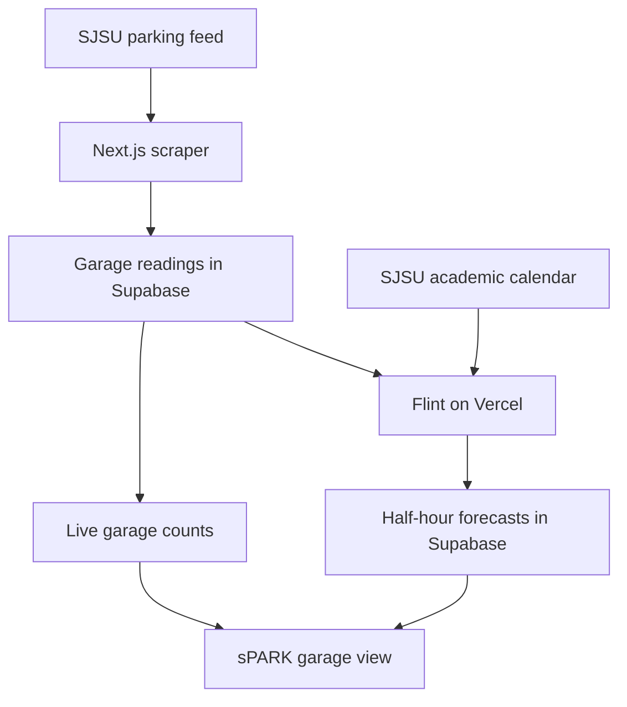

<h1 align="center">
  <picture>
    <source media="(prefers-color-scheme: dark)" srcset="./web-app/public/icons/logos/spark-readme-dark.svg">
    
  </picture>
</h1>
<p align="center">
  <strong>Park Smart - Made by students for students.</strong>
</p>

<p align="center">
  Smart parking predictions for San Jose State University
</p>

<p align="center">
  <a href="https://nextjs.org/"></a>
  <a href="https://supabase.com/"></a>
  <a href="https://www.python.org/"></a>
  <a href="https://scikit-learn.org/stable/"></a>
  <a href="https://flask.palletsprojects.com/en/stable/"></a>
  
  <br><br>
  <a href="https://sparkparking.vercel.app/"><strong>Try the sPARK beta</strong></a>
  <br><br>
  If you find this project helpful, please consider giving it a ⭐ on GitHub!
</p>

---

## Table of Contents

-   [📖 About](#about)
-   [✨ Features](#features)
-   [🪨 Flint & 🧪 sPARK Lab](#flint)
-   [🔄 How It Works](#how-it-works)
-   [🧩 Roadmap](#roadmap)
-   [🛠️ Technologies Used](#technologies-used)
-   [📚 Getting Started](#getting-started)
-   [⚙️ Running the Application](#running-the-application)
-   [🔧 Environment Variables](#environment-variables)
-   [🤝 Contributing](#contributing)
-   [📜 License](#license)

---

<a id="about"></a>

## 📖 About

sPARK is a web platform that forecasts parking availability for San Jose State University. It shows live garage occupancy and forecasts from Flint, a model I trained on historical garage readings.

With sPARK, you can decide where to park before you head to campus. Check which garages have space now, or pick an arrival time to see how full they’re expected to be when you get there.

I built sPARK as an independent project because finding parking was a problem for me and a lot of my friends at school. I’ve heard stories of students getting to campus hours before class just to make sure they find a spot. I wanted to make it easier to decide when to leave and where to park, so we could spend less time looking for a spot and get to class on time.

---

<a id="features"></a>

## ✨ Features

- **Live Parking & Forecasts**

  - See live space counts for all 4 SJSU garages
  - Check forecasts for all garages up to six days ahead

- **Find the Right Garage**

  - Sort by spaces left or how full garages are
  - Find the garage with the shortest walk to your building and open walking directions in Google Maps
  - Compare accessible, employee, 20-minute, motorcycle, and EV spaces across garages

- **Garage Details**

  - Explore each garage’s daily forecast on an interactive chart
  - Check hours, permits, and payment options
  - Get driving directions to the garage in Google Maps

- **Design**

  - Clean, simple interface
  - Switch dates and times quickly to compare forecasts
  - Responsive (ish 😭) UI
  - Learn how to use the app with a short interactive onboarding guide

- **Beta Feedback**

  - Send feedback right from the app

---

<a id="flint"></a>

##  Flint & 🧪 sPARK Lab

Flint is a gradient-boosted tree model I trained, tested, and deployed to predict how full SJSU’s garages will be at a given time.

### How I trained it

I trained [Flint v0.3](lab/models/flint_v0.3/README.md) using scikit-learn’s `HistGradientBoostingRegressor` on **58,795 garage readings** I collected from October 21, 2025 through September 19, 2026 (**334 days**).

The model uses nine features across three groups.

- **Garage and time**
  - `lot_id`: Which garage
  - `weekday`: Day of the week
  - `minute_of_day`: Minutes since midnight Pacific time
- **Calendar**
  - `calendar`: Academic term type or break
  - `days_into_calendar`: Days since the term started
  - `days_until_term_end`: Days until the term ends
  - `is_us_holiday`: Whether it’s an observed U.S. federal holiday
- **Occupancy history**
  - `recent_same_regime_slot`: Average occupancy at the same time on comparable days in the past two weeks
  - `lag_7`: Occupancy at the same time last week

I added an opening curve based on past opening weeks to help Flint account for the jump in demand when classes start. It applies on class weekdays in the first 7 days of instruction and helped the model a lot in the fall replay.

In the future, with more opening week data, I want to see if the model can learn that pattern on its own.

### How I tested it

I compared [Flint v0.3](lab/experiments/flint_v0.3/README.md) with [Flint v0.2](lab/experiments/flint_v0.2/README.md) on **32,135 garage readings**. The saved three-week forecasts covered **31,602** of those readings and were usually issued about six days ahead.

For example, to test a 10:00am Flint prediction, I used what the model would have known by 9:30am and checked its prediction against the actual 10:00am reading.

I measured mean absolute error (MAE) in occupancy percentage points. If $e_i = \hat{y}_i - y_i$ is the difference between predicted and actual occupancy, then

$$
\mathrm{MAE} = \frac{1}{n}\sum_{i=1}^{n}|e_i|
$$

| Average error | Saved three-week average | Flint v0.2 | Flint v0.3 |
| --- | ---: | ---: | ---: |
| All daytime slots | 10.96 | 8.46 | **5.57** |
| Regular class days | 7.49 | 6.46 | **4.11** |
| Campus holidays | 17.24 | 15.01 | **4.77** |
| Spring opening week | 37.07 | **8.32** | 20.04 |
| Fall opening week | 45.54 | 13.59 | **7.78** |

I also tested how much the opening curve itself helped during the first week of fall classes.

| Fall opening week | Average error |
| --- | ---: |
| Saved three-week average | 45.54 |
| Flint v0.2 | 13.59 |
| Flint v0.3 trees alone | 14.73 |
| Flint v0.3 with the opening curve | 8.63 |
| Flint v0.3 with the opening curve and clearing update | **7.78** |

Links: [sPARK Lab](lab/README.md), [Full results and training steps](lab/experiments/flint_v0.3/README.md)

---

<a id="how-it-works"></a>

## 🔄 How It Works



- **Forecasts**
  - A scheduled job asks Flint for forecasts for the rest of today and the next six days
  - Flint predicts how full each garage will be in 30-minute slots
  - The job saves those predictions in a Supabase table
  - The app reads the saved forecasts so we don’t have to recompute them each time someone opens the app or changes the time

- **Walking Distances & Trip Planning**
  - When you pick a campus building, sPARK uses OpenRouteService to calculate the walk from each garage
  - The API saves those walking distances in Supabase so it can reuse them when someone picks the same building
  - The trip recommendation API ranks garages by travel time and predicted occupancy

- **Analytics & Feedback**
  - PostHog tracks when people sort garages, change the forecast time, or open directions
  - The beta feedback form sends messages through an API that checks each submission

---

<a id="roadmap"></a>

## 🧩 Roadmap

-   🚧 **In Progress**

    -   UI polish and beta feedback
    -   “Plan Your Trip” feature (recommendations for best garage, leave time, and walking distance)

-   🚀 **Planned**
    -   **AI Schedule Parser / Planner**\
        Upload a screenshot of your class schedule and sPARK will use AI to extract your classes and buildings, calculate recommended leave times for each day, and prefill the trip planner. Includes multiple schedules, editable plans, and automatic trip planning.
    -   **Notifications**\
        Receive leave-time reminders and alerts if your preferred garages are nearing capacity or trip conditions change.

---

<a id="technologies-used"></a>

## 🛠️ Technologies Used

-   **Frontend** uses Next.js, React, CSS, Framer Motion, and SWR.
-   **Backend** uses Node.js, Cheerio, Supabase Postgres and Realtime, Redis, and Arcjet.
-   **Maps & routing** use Google Maps, OpenRouteService, and OpenCage.
-   **Forecasting** uses Python with pandas and NumPy for data prep, scikit-learn for training, joblib for the saved model, and Flask for serving predictions.
-   **Analytics & feedback** use PostHog.
-   **Deployment** runs on Vercel.

---

<a id="getting-started"></a>

## 📚 Getting Started

### Prerequisites

-   [Node.js](https://nodejs.org/) (v22 recommended)
-   [npm](https://www.npmjs.com/) (v10+ recommended)
-   Python 3.13 if you’re running Flint or working in the lab

### Installation

1. **Clone the Repository**

    ```bash
    git clone https://github.com/ItaiHammer/sPARK.git
    cd sPARK
    ```

2. **Install Dependencies**
    ```bash
    cd web-app
    npm ci
    ```

---

<a id="running-the-application"></a>

## ⚙️ Running the Application

Set up `web-app/.env.local` using the settings below. Then, from `web-app/`, run:

```bash
npm run dev
```

Open [http://localhost:3000](http://localhost:3000). The app reads live occupancy and saved forecasts from your Supabase project, so use a development database with the sPARK schema and parking data. To generate forecasts yourself, follow the [forecasting setup](web-app/src/app/api/cron/forecast/README.md).

---

<a id="environment-variables"></a>

## 🔧 Environment Variables

Add the settings for the features you’re working on to `web-app/.env.local`.

| Used for | Variables |
| --- | --- |
| Garage data and saved forecasts | `SUPABASE_PROJECT_URL`, `SUPABASE_SERVICE_ROLE_KEY` |
| App API requests | `INTERNAL_API_KEY`, `NEXT_PUBLIC_INTERNAL_API_KEY` |
| API protection and caching | `ARCJET_KEY`, `REDIS_URL` (host), `REDIS_PORT`, `REDIS_PASSWORD` |
| Supabase Realtime updates | `NEXT_PUBLIC_SUPABASE_PROJECT_URL`, `NEXT_PUBLIC_SUPABASE_ANON_KEY` |
| Walking distances and address lookup | `OPENROUTE_SERVICE_URL`, `OPENROUTE_SERVICE_API_KEY`, `OPENCAGE_API_KEY` |
| Beta feedback and analytics | `NEXT_PUBLIC_POSTHOG_PROJECT_TOKEN`, `NEXT_PUBLIC_POSTHOG_HOST` |
| Forecast job and Flint service | `FORECASTING_API_KEY`, `FLINT_SERVICE_URL` |
| Occupancy scraper | `SCRAPING_API_KEY`, `SCRAPER_USER_AGENT` |
| Share previews | `NEXT_PUBLIC_WEB_APP_URL` |

For local testing, give both app API key variables the same development-only value. Variables starting with `NEXT_PUBLIC_` are visible in the browser. Keep your service role key and other server credentials in server-side variables.

---

<a id="contributing"></a>

## 🤝 Contributing

Contributions are welcome! Open an issue or submit a pull request with features or bug fixes.

---

<a id="license"></a>

## 📜 License

This project is licensed under the MIT License.

[Back to top](#table-of-contents)
