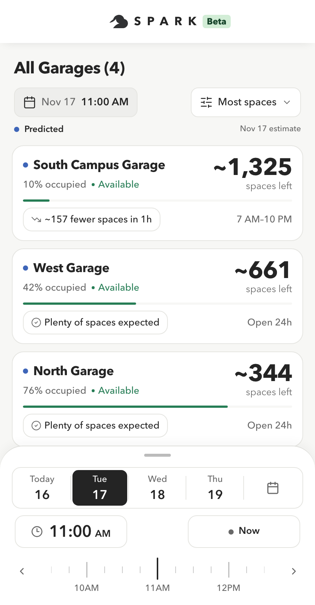
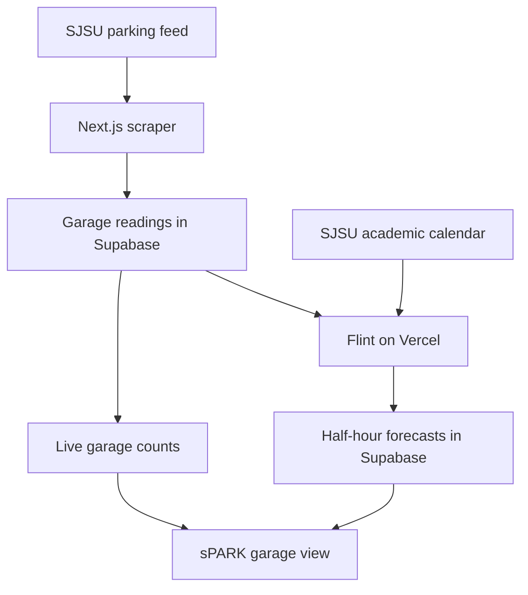

<h1 align="center">
  <picture>
    <source media="(prefers-color-scheme: dark)" srcset="./web-app/public/icons/logos/spark-readme-dark.svg">
    
  </picture>
</h1>
<p align="center">
  Smart parking predictions for San Jose State University
</p>

<p align="center">
  <a href="https://nextjs.org/"></a>
  <a href="https://supabase.com/"></a>
  <a href="https://www.python.org/"></a>
  <a href="https://scikit-learn.org/stable/"></a>
  <a href="https://flask.palletsprojects.com/en/stable/"></a>
  
  <br><br>
  <a href="https://sparkparking.vercel.app/"><strong>Try the sPARK beta</strong></a>
  <br><br>
  If you find this project helpful, please consider giving it a ⭐ on GitHub!
</p>

---

## Table of Contents

- [📖 About](#about)
- [✨ Features](#features)
- [🪨 Flint & 🧪 sPARK Lab](#flint)
- [🔄 How It Works](#how-it-works)
- [🧩 Roadmap](#roadmap)
- [🛠️ Technologies Used](#technologies-used)
- [📚 Getting Started](#getting-started)
- [🔧 Environment Variables](#environment-variables)
- [🤝 Contributing](#contributing)
- [📜 License](#license)

---

<a id="about"></a>

## 📖 About

<p align="center">
  <a href="https://sparkparking.vercel.app/">
    
  </a>
</p>

sPARK is a web app that forecasts parking availability for San Jose State University. It shows live garage occupancy and forecasts from Flint, a model I trained on historical garage readings.

With sPARK, you can decide where to park before you head to campus. Check which garages have space now, or pick an arrival time to see how full they’re expected to be when you get there.

I built sPARK as an independent project because finding parking was a problem for me and a lot of my friends at school. I’ve heard stories of students getting to campus hours before class just to make sure they find a spot. I wanted to make it easier to decide when to leave and where to park, so we could spend less time looking for a spot and get to class on time.

---

<a id="features"></a>

## ✨ Features

- **Live Parking & Forecasts**
  - See live space counts for all 4 SJSU garages
  - Check forecasts for all garages up to six days ahead

- **Find the Right Garage**
  - Sort by spaces left or how full garages are
  - Find the garage with the shortest walk to your building and open walking directions in Google Maps
  - Compare accessible, employee, 20-minute, motorcycle, and EV spaces across garages

- **Garage Details**
  - Explore each garage’s daily forecast on an interactive chart
  - Check hours, permits, and payment options
  - Get driving directions to the garage in Google Maps

- **Design**
  - Clean, simple interface
  - Switch dates and times quickly to compare forecasts
  - Responsive (ish 😭) UI
  - Learn how to use the app with a short interactive onboarding guide

- **Beta Feedback**
  - Send feedback right from the app

---

<a id="flint"></a>

##  Flint & 🧪 sPARK Lab

Flint is a gradient-boosted tree model I trained, tested, and deployed to predict how full SJSU’s garages will be at a given time.

### How I trained it

I trained [Flint v0.3](lab/models/flint_v0.3/README.md) using scikit-learn’s `HistGradientBoostingRegressor` on **58,795 garage readings** I collected from October 21, 2025 through September 19, 2026 (**334 days**).

The model uses 9 features across three groups.

- **Garage and time**
  - `lot_id`: Which garage
  - `weekday`: Day of the week
  - `minute_of_day`: Minutes since midnight Pacific time
- **Calendar**
  - `calendar`: Academic term type or break
  - `days_into_calendar`: Days since the term started
  - `days_until_term_end`: Days until the term ends
  - `is_us_holiday`: Whether it’s a federal holiday
- **Occupancy history**
  - `recent_same_regime_slot`: Average occupancy at the same time on comparable days in the past two weeks
  - `lag_7`: Occupancy at the same time last week

I added an opening curve based on past opening weeks to help Flint account for the jump in demand when classes start. It applies on class weekdays in the first 7 days of instruction and helped the model a lot in the fall replay.

In the future, with more opening week data, I want to see if the model can learn that pattern on its own.

### How I tested it

I compared [Flint v0.3](lab/experiments/flint_v0.3/README.md) with [Flint v0.2](lab/experiments/flint_v0.2/README.md) on **32,135 garage readings**. The saved 3 week avg baseline forecasts covered **31,602** of those readings and were usually issued about 6 days ahead.

For example, to test a 10:00am Flint prediction, I used what the model would have known by 9:30am and checked its prediction against the actual 10:00am reading.

I measured mean absolute error (MAE) in occupancy percentage points. If $e_i = \hat{y}_i - y_i$ is the difference between predicted and actual occupancy, then

$$
\mathrm{MAE} = \frac{1}{n}\sum_{i=1}^{n}|e_i|
$$

| Average error       | 3 week average | Flint v0.2 | Flint v0.3 |
| ------------------- | -------------: | ---------: | ---------: |
| All daytime slots   |          10.96 |       8.46 |   **5.57** |
| Regular class days  |           7.49 |       6.46 |   **4.11** |
| Campus holidays     |          17.24 |      15.01 |   **4.77** |
| Spring opening week |          37.07 |   **8.32** |      20.04 |
| Fall opening week   |          45.54 |      13.59 |   **7.78** |

I also tested how much the opening curve itself helped during the first week of fall classes.

| Fall opening week                                     | Average error |
| ----------------------------------------------------- | ------------: |
| Saved three-week average                              |         45.54 |
| Flint v0.2                                            |         13.59 |
| Flint v0.3 trees alone                                |         14.73 |
| Flint v0.3 with the opening curve                     |          8.63 |
| Flint v0.3 with the opening curve and clearing update |      **7.78** |

Links: [sPARK Lab](lab/README.md), [Full results and training steps](lab/experiments/flint_v0.3/README.md)

---

<a id="how-it-works"></a>

## 🔄 How It Works



- **Forecasts**
  - A scheduled job asks Flint for forecasts for the rest of today and the next six days
  - Flint predicts how full each garage will be in 30 minute increments
  - The job saves those predictions in a Supabase table
  - The app reads the saved forecasts from the supabase table so we don’t have to recompute them each time someone asks for them

- **Walking Distances & Trip Planning**
  - When you pick a building, sPARK uses OpenRouteService to calculate the walk from each garage
  - The API saves those walking distances in Supabase so it can reuse them when someone picks the same building/garage combo
  - The trip recommendation API ranks garages by travel time and predicted occupancy

- **Analytics & Feedback**
  - PostHog tracks when people sort garages, change the forecast time, or open directions
  - The beta feedback form sends messages through an API that checks each submission

---

<a id="roadmap"></a>

## 🧩 Roadmap

- 🚧 **In Progress**
  - **UI Redesign**
    - Redesign parts of the app to make them look better and easier to use

- 💡 **Potential Features**
  - **Plan Your Trip**
    - Enter where you’re leaving from, your campus building, and when you need to arrive
    - Get a garage recommendation based on expected availability when you get there
    - See when to leave so you have time to park and walk to class

  - **Notifications**
    - Get a reminder when it’s time to leave
    - Get an alert when your garage is expected to fill up

  - **Saved Schedules**
    - Save and edit your class times and buildings for future trips

  - **AI Schedule Planner**
    - Upload a schedule screenshot to fill in your saved schedule and plan trips from it

---

<a id="technologies-used"></a>

## 🛠️ Technologies Used

- **Frontend**
  - **Next.js**
    - **React**
      - Builds the garage cards and time picker
    - **Tailwind CSS**
      - Provides utility styles for the app
    - **Framer Motion**
      - Animates the time picker and onboarding

- **Backend & Database**
  - **Node.js**
    - **Cheerio**
      - Extracts garage occupancy from the SJSU parking page
  - **Supabase**
    - **Postgres**
      - Stores garage readings, forecasts, and walking distances
    - **Realtime**
      - Refreshes live counts when new readings arrive

- **Machine Learning**
  - **Python**
    - **pandas**
      - Cleans and prepares historical garage readings
    - **scikit-learn**
      - Trains and evaluates Flint’s gradient-boosted trees
    - **Flask**
      - Serves predictions to the scheduled forecast job

- **Maps & Routing**
  - **Google Maps**
    - Shows garage maps and opens driving and walking directions
  - **OpenRouteService**
    - Calculates walking distances to campus buildings

- **Hosting**
  - **Vercel**
    - Hosts the web app and Flint’s forecast service

- **Analytics**
  - **PostHog**
    - Tracks feature usage and collects beta feedback

---

<a id="getting-started"></a>

## 📚 Getting Started

Use Node.js 22 and npm 10+.

### Install

```bash
git clone https://github.com/ItaiHammer/sPARK.git
cd sPARK/web-app
npm ci
```

<a id="running-the-application"></a>

### Run locally

Add your [environment variables](#environment-variables) to `web-app/.env.local`, then run this from `web-app/`.

```bash
npm run dev
```

Open [http://localhost:3000](http://localhost:3000).

If you want to run Flint locally, use Python 3.13 and follow the [forecasting setup](web-app/src/app/api/cron/forecast/README.md).

---

<a id="environment-variables"></a>

## 🔧 Environment Variables

Add your settings to `web-app/.env.local`. Use a Supabase development project with the sPARK schema and garage data.

| Service or feature                                                                               | Variables                                                           |
| ------------------------------------------------------------------------------------------------ | ------------------------------------------------------------------- |
| [Supabase Postgres](https://supabase.com/docs/guides/database/overview)                          | `SUPABASE_PROJECT_URL`, `SUPABASE_SERVICE_ROLE_KEY`                 |
| [Supabase Realtime](https://supabase.com/docs/guides/realtime)                                   | `NEXT_PUBLIC_SUPABASE_PROJECT_URL`, `NEXT_PUBLIC_SUPABASE_ANON_KEY` |
| [App API](web-app/src/proxy.js)                                                                  | `INTERNAL_API_KEY`, `NEXT_PUBLIC_INTERNAL_API_KEY`                  |
| [Arcjet](https://docs.arcjet.com/)                                                               | `ARCJET_KEY`                                                        |
| [Redis](https://redis.io/docs/latest/)                                                           | `REDIS_URL`, `REDIS_PORT`, `REDIS_PASSWORD`                         |
| [OpenRouteService](https://giscience.github.io/openrouteservice/api-reference/endpoints/matrix/) | `OPENROUTE_SERVICE_URL`, `OPENROUTE_SERVICE_API_KEY`                |
| [OpenCage](https://opencagedata.com/)                                                            | `OPENCAGE_API_KEY`                                                  |
| [PostHog](https://posthog.com/docs)                                                              | `NEXT_PUBLIC_POSTHOG_PROJECT_TOKEN`, `NEXT_PUBLIC_POSTHOG_HOST`     |
| [Flint forecast job](web-app/src/app/api/cron/forecast/README.md)                                | `FORECASTING_API_KEY`                                               |
| [Vercel Services](https://vercel.com/docs/services)                                              | `FLINT_SERVICE_URL`                                                 |
| [SJSU garage scraper](web-app/src/app/api/locations/%5Blocation_id%5D/scrape/route.js)           | `SCRAPING_API_KEY`, `SCRAPER_USER_AGENT`                            |
| [Link previews](web-app/src/app/layout.js)                                                       | `NEXT_PUBLIC_WEB_APP_URL`                                           |
| [Next.js runtime](https://nextjs.org/docs/app/guides/environment-variables)                      | `NODE_ENV` (set by Next.js)                                         |

Use the same development-only value for both app API keys. `NEXT_PUBLIC_` variables are visible in the browser.

---

<a id="contributing"></a>

## 🤝 Contributing

Contributions are welcome! Open an issue or submit a pull request with features or bug fixes.

---

<a id="license"></a>

## 📜 License

The sPARK source code and documentation are licensed under the [MIT License](LICENSE). Third-party material remains subject to its own terms.

[Back to top](#table-of-contents)
